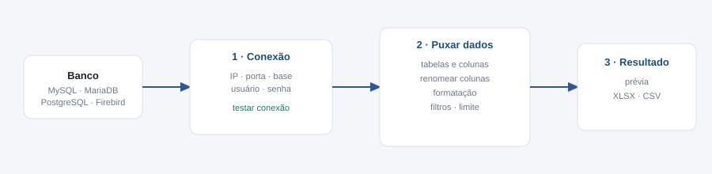

# Puxador de Dados

Portal web para **extrair dados de qualquer banco** (MySQL, MariaDB, PostgreSQL e Firebird), renomear e
formatar cada coluna e gerar a planilha pronta — sem escrever SQL e sem instalar cliente de banco na
máquina de quem usa.

Roda em **Windows**, **Ubuntu/Linux** e **Docker**. Interface em português, sem build de front-end,
sem banco intermediário: a configuração fica num SQLite local na pasta `data/`.



## O que ele resolve

Você tem um ERP (Eptus, Protheus, Bling, planilha, o que for) e precisa mandar os produtos para outra
ferramenta — mas a planilha de destino tem cabeçalhos próprios, e o banco tem nomes técnicos.
O Puxador de Dados faz a ponte:

```
banco  →  escolher tabela  →  escolher colunas  →  renomear + formatar  →  XLSX / CSV
```

Exemplo real: no banco a coluna é `Id`, `Descricao`, `ValorVendaVarejo`.
Na planilha tem que sair `cod produto`, `descricao`, `valor unitario` — com preço em R$ e descrição em
maiúsculas. Você ajusta isso na tela e exporta.

## As três telas

| Tela | O que faz |
|---|---|
| **1 · Conexões** | cadastro do servidor (IP, porta, base, usuário, senha), com botão **Testar conexão** antes de salvar |
| **2 · Puxar dados** | lista as tabelas e as colunas do banco, permite marcar colunas, **renomear** cada uma para o nome que vai na planilha, escolher a **formatação** (texto, número, moeda, data, maiúsculo…), **relacionar tabelas** (`item.IdFabricante` → `fabricante.Descricao`), filtros (inclusive data com calendário e período) e limite |
| **3 · Resultado** | prévia dos dados, contagem de registros, SQL gerado e exportação em **Excel (.xlsx)** ou **CSV** — com botão **Voltar** que preserva o que você já tinha configurado |

## Bancos suportados (v1)

| Banco | Versões testadas | Observação |
|---|---|---|
| MySQL | 5.7 / 8.x | usa `mysql2` |
| MariaDB | 10.x / 11.x | mesmo driver do MySQL |
| PostgreSQL | 12+ | suporta `schema` (padrão `public`) |
| Firebird | 2.5, 3.0, 4.0 | no campo *base* vai o **caminho do .fdb** no servidor |

Detalhes e limitações em [docs/v1/CONECTORES.md](docs/v1/CONECTORES.md).

## Instalação rápida

### Windows

1. Baixe o repositório (Code → Download ZIP) ou clone.
2. Clique com o botão direito em **`INSTALAR.cmd`** → *Executar*.
3. O instalador verifica o Node.js, instala as dependências, cria o atalho e abre em `http://localhost:8790`.

Depois disso, use o atalho **Puxador de Dados** na área de trabalho.

```powershell
# instalação manual, a partir da pasta do projeto
npm install
npm start
```

### Ubuntu / Linux

Um comando, usando **Docker e a imagem publicada** (não precisa de Node nem clonar o código):

```bash
curl -fsSL https://raw.githubusercontent.com/SamuelNoia/puxador/main/instalar.sh | sh
```

Personalizando: `PORT=8800 sh instalar.sh`, `ACCESS_PASSWORD=senha sh instalar.sh`,
`DATA_DIR=/srv/puxador/data sh instalar.sh`. Rodar de novo atualiza o container mantendo os dados.

Sem Docker? Instalação nativa em Node:

```bash
MODO=native sh instalar.sh
# ou, dentro do projeto:
npm install && npm start
```

Para rodar como serviço: veja [docs/v1/INSTALACAO.md](docs/v1/INSTALACAO.md#systemd).

### Docker

```bash
docker compose up -d
# acesse http://localhost:8790
```

Ou sem compose:

```bash
docker build -t puxador-dados .
docker run -d --name puxador -p 8790:8790 -v "$PWD/data:/data" puxador-dados
```

## Configuração (variáveis de ambiente)

| Variável | Padrão | Para que serve |
|---|---|---|
| `PORT` | `8790` | porta HTTP |
| `HOST` | `0.0.0.0` | interface de escuta |
| `DATA_DIR` | `./data` | onde ficam `puxador.db` e `secret.key` |
| `ACCESS_PASSWORD` | *(vazio)* | se definida, exige senha para entrar no portal |
| `PREVIEW_LIMIT` | `500` | linhas máximas na prévia |
| `MAX_ROWS` | `500000` | limite de segurança por exportação |
| `QUERY_TIMEOUT_MS` | `120000` | tempo máximo de uma consulta |

## Segurança

- As senhas dos bancos são gravadas **cifradas** (AES-256-GCM) com uma chave gerada na primeira execução
  (`data/secret.key`, permissão 600). A senha nunca volta para o navegador — a API só informa `temSenha`.
- Todo SQL é montado com **identificadores citados** e **valores parametrizados**; não há concatenação de
  valores digitados pelo usuário na consulta.
- O portal nasce **sem login**, pensado para rede interna. Para expor na rede, defina `ACCESS_PASSWORD`.
- Recomenda-se usar um usuário de banco **somente leitura** para o Puxador.

## Estrutura do projeto

```
server.js              servidor HTTP (sem framework)
src/
  config.js            portas, pastas, limites
  db.js                SQLite local (node:sqlite)
  crypto.js            cifra das senhas
  query.js             montagem de SQL por dialeto
  format.js            formatações (texto, moeda, data…)
  export.js            geração de XLSX e CSV
  xlsx.js              engine XLSX própria (zero dependência)
  web.js               roteador e utilitários HTTP
  auth.js              senha opcional do portal
  drivers/             mysql, postgres, firebird + registro
  routes/              endpoints REST
public/                index.html, app.css, app.js (SPA sem build)
tools/selftest.js      teste ponta a ponta
docs/v1/               documentação da versão 1
```

## Documentação

- [Manual de uso](docs/v1/MANUAL.md)
- [Instalação e operação](docs/v1/INSTALACAO.md)
- [Conectores e limitações](docs/v1/CONECTORES.md)
- [API REST](docs/v1/API.md)
- [Arquitetura](docs/v1/ARQUITETURA.md)
- [Changelog](docs/v1/CHANGELOG.md)

## Testes

```bash
npm start              # em um terminal
npm test               # em outro: 17 verificações ponta a ponta
```

Para testar contra um banco real:

```bash
TEST_HOST=10.0.1.67 TEST_PORT=3307 TEST_DB=z_prod TEST_USER=usuario TEST_PASS=senha \
TEST_TABLE=item npm test
```

## Licença

MIT — veja [LICENSE](LICENSE).
